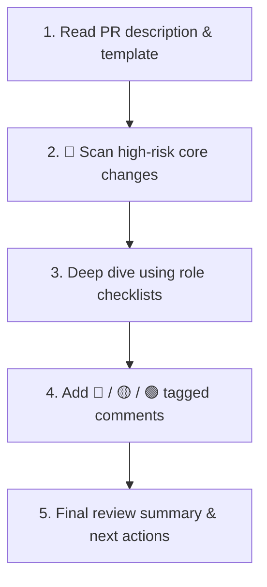

# High-ROI Code Review Workflow

## Purpose

Guide high-ROI code reviews focusing on correctness, critical security flaws, edge-case risks, and maintainability under the squad's accountable owners.
[한국어 안내: SKILL_ko.md](SKILL_ko.md)

## Prerequisites

- Operating System: Windows, macOS, Linux
- Dependencies: None. Standard code review environment.

## Superpowers workflow ownership

If both packages participate, first read the [ownership contract](../engineering-squad/references/superpowers-compatibility_en.md). Use verified qualified identities and a single planning/evidence record; reuse valid approvals and supplement only missing scope. Keep mandatory kickoff confirmation, distinct review purposes and current-head independent security gates.

---

## 1. 3-Tier Severity Rubric

Every review comment should use a clear severity tag so the author knows what blocks merging:

| Tag | Level | Description | Merge Requirement |
| :---: | :--- | :--- | :--- |
| 🔴 | **[Must Fix]** | Bugs, data loss risks, release-blocking security flaws, memory leaks, serious slowdowns, or irreversible schema changes | **Must be fixed before merging** |
| 🟡 | **[Inquire & Verify]** | Unclear design choices, potential side effects, missing edge cases, or trade-offs | **Author must clarify or answer** |
| 🟢 | **[Suggestion]** | Readability improvements, minor cleanup, optional patterns, or small optimizations | **Author's choice (does not block merging)** |

*For full guidelines and design pattern rules, see [review-rubric_en.md](./references/review-rubric_en.md).*

---

## 2. Core Review Principles

1. **High ROI First**:
   - Leave formatting, spaces, and semicolons to linters. Put 80%+ of your review effort into **business logic bugs, race conditions, edge cases, and failure risks**.
2. **Grounded in SOLID & Design Patterns**:
   - Avoid subjective feedback like "I just prefer this way." Back up your advice with solid principles: **Single Responsibility (SRP), Open-Closed (OCP), loose coupling, or Strategy/Factory patterns**.
3. **Tailored by Role**:
   - Review code through the lens of specific roles (Product Planner, Product Marketing, Finance / FinOps, AI Agent Engineer, Frontend, Backend, Data, QA, Test Engineer, Security Review Engineer, Compliance Reviewer, DevOps, SRE). (See [role-checklists_en.md](./references/role-checklists_en.md))

---

## 3. Review Steps



1. **Understand Context**: Read the PR description, trade-offs, and risk table first to see what the author intends to do.
2. **Check High-Risk Areas First**: Prioritize database transactions, auth, 3rd-party API calls, and core business state transitions.
3. **Role-Specific Checks**:
   - Frontend: Extra re-renders, bundle size, error boundaries.
   - Backend: N+1 queries, concurrency locks, clean exception handling.
   - Data: Index coverage, safe Up/Down migrations.
   - QA: Corner case and negative scenario tests.
   - DevOps/SRE: Exposed secrets, container resource limits, health checks, and metrics.
4. **Offer Concrete Solutions**: When pointing out an issue, always explain **why it is a problem** and share a **minimal code snippet showing the fix**.


## Mandatory security disposition

At QA Stage 3, activate an independent Security Review Engineer and apply [security-review_en.md](../engineering-squad/references/security-review_en.md). QA green and ROI/cost priorities cannot waive the security gate. Map release blockers to Must Fix; Medium/Low residual-risk acceptance follows that contract and any stricter organizational policy.


## Required PR merge criteria

Require an independent Security Review Engineer PASS and report for the latest PR head before every merge, including documentation/configuration changes. Apply the [required PR merge gate](../engineering-squad/references/security-review_en.md#required-pr-merge-gate). Missing/BLOCKED/stale review prevents merge. New commits or changed merge inputs require re-review; QA, general approval and green CI cannot substitute for security PASS.

Security coordinates the Compliance Reviewer capability and checks relevant Korean/U.S. IT legal and security-related compliance; see [compliance responsibility](../engineering-squad/references/roles_en.md). Record sources, applicability and actions; unresolved applicable violations block merge.

## Examples

```markdown
# 3-Tier Severity Review Comments:
🔴 [Must Fix]: Missing database transaction on debit operation. If the subsequent call fails, account state becomes inconsistent.
🟡 [Inquire & Verify]: What is the fallback behavior if Redis is temporarily unreachable?
🟢 [Suggestion]: Consider using `Enum` instead of raw string literals for status codes.
```

## Limitations

- Does not nitpick spacing, semicolons, or formatting; delegate purely stylistic concerns to automated linters.
- General peer approval cannot substitute for an independent Security Review Engineer PASS on the current head.

## Troubleshooting

- **Error**: `ReviewBlockerDeadlock`
  - **Cause**: Reviewer and author disagree on architectural abstraction or pattern choice.
  - **Solution**: Escalate to the Tech Lead for binding resolution or fallback to standard library minimalism.
- **Error**: `StaleReviewApproval`
  - **Cause**: PR branch received new commits after review was recorded.
  - **Solution**: Automatically revoke approval; re-verify test suite and request updated security sign-off.
