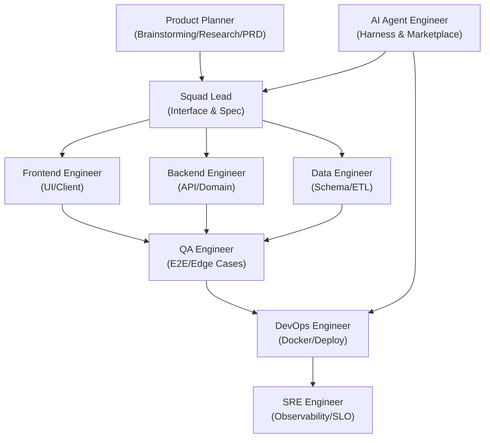

# dev-team-skills

[English](README.md) | [한국어](README_ko.md)

> A cross-platform (Windows & macOS) collection of AI coding agent skills and rules, inspired by Andrej Karpathy's engineering philosophy and practical senior engineering principles.  
> It helps you run an 8-role engineering squad (Product Planner, AI Agent Engineer, Frontend, Backend, Data, QA, DevOps, SRE) across major AI environments like **Google Antigravity**, **Claude Code**, **OpenAI Codex**, and **Cursor**, using **deterministic harness engineering** and **marketplace packaging standards** to ship reliable software.

---

## 🌟 Why is dev-team-skills better?

Compared to simple prompt lists or one-off agent skills, `dev-team-skills` gives you clear advantages:

| Feature | Typical Prompt / Rule Lists | **dev-team-skills** |
| :--- | :--- | :--- |
| **Team Coverage** | Only single-coder or simple pair programming | **Full lifecycle squad of 8 roles: planning, AI harness, dev, QA, deployment, and SRE** |
| **Quality Check** | Relies on LLM hallucination ("I finished it") | **Deterministic evaluation harness (`verify-harness`) and self-healing loop** |
| **Packaging & Ecosystem**| Manual copy-pasting of text files | **100% compliant with Antigravity, Claude Code, and OpenAI Codex marketplaces** |
| **Engineering Mindset** | Unnecessary boilerplate and too many libraries | **Karpathy principles & Ponytail (Standard Library First, YAGNI, minimum code)** |
| **Communication** | Long, robotic, and tiring AI explanations | **Kakao Pay style PR template, next-action-first (ADHD-friendly), natural tone** |
| **Cross-Platform** | Fails often on Windows due to Linux-only commands | **Equal support for Windows (PowerShell) and macOS/Linux (Bash) with CI tests** |

---

## 🏛️ Constitution & Principles

[`GEMINI.md`](./GEMINI.md) | [`CLAUDE.md`](./CLAUDE.md) | [`CODEX.md`](./CODEX.md) | [`AGENTS.md`](./AGENTS.md)

1. **Don't assume. Don't hide confusion.**
   - Never write code based on assumptions if requirements are unclear. Show trade-offs and confirm with the user.
2. **Minimum code & Standard library first. (Ponytail & YAGNI)**
   - "The best code is the code you never wrote." Always try the standard library and native OS tools before adding external packages.
3. **Touch only what you must. Clean up your mess.**
   - Do not edit files or reformat code outside your task scope. Clean up temporary scripts and test data before finishing.
4. **Define success criteria. Loop until verified.**
   - Define a clear Definition of Done before finishing. Run real build, test, and health check commands to prove your solution works.
5. **High-Impact Communication & ADHD Optimization**
   - Skip long greetings. Lead with the conclusion and immediate next action. Focus on one step at a time.
6. **Cross-Platform Compatibility (Windows & macOS)**
   - Provide tested commands and scripts for both Windows (PowerShell) and macOS/Linux (Bash).

---

## 📦 Skills Collection

| Skill Name | Description | Key Features |
| :--- | :--- | :--- |
| **`engineering-squad`** | 8-role agent squad & 6-step deployment pipeline | Clear collaboration across planning, harness, dev, QA, deployment, and SRE |
| **`brainstorming`** | Product planning, problem definition & idea generation | SCAMPER, HMW, RICE scoring, Lean PRD template, linked with `research` subagent |
| **`harness-engineering`** | AI agent evaluation harness & marketplace packaging | Deterministic oracles, 3-platform packaging (`plugin.json`, `.claude-plugin`, `.codex-plugin`), self-healing loop |
| **`code-review`** | High-ROI design pattern reviews by role | 3 severity tiers (🔴Must Fix / 🟡Review Needed / 🟢Suggestion), tailored checklists |
| **`ponytail`** | Pragmatic senior minimalist mindset | Standard library first, zero bloat, remove unnecessary dependencies |
| **`humanizer`** | AI prose pattern remover (English) | Strips AI staging, forced triads, empty filler, and robotic formality based on Wikipedia's guide |
| **`humanizer-kr`** | Natural Korean technical writing | Removes stiff AI translations, fixes awkward passive voice, keeps technical meaning |
| **`i-have-adhd`** | Focus workflow to prevent cognitive overload | Leads with next action, finishes with one single task, cuts distraction |

---

## 👥 Engineering Squad: 8 Specialized Roles & DoD



| Role | Scope | Required Definition of Done (DoD) |
| :--- | :--- | :--- |
| **Product Planner** | Problem definition, brainstorming, market research, Lean PRD | Lean PRD complete with hypothesis, MVP scope, acceptance criteria |
| **AI Agent Engineer** | Agent eval harness, tool schemas, marketplace packaging | Verification harness script passes with full green report |
| **Squad Lead** | Task breakdown, interface contracts, agent coordination | E2E integration scenario passes |
| **Frontend** | UI components, client state, API calls, browser UI | Production build passes (`npm run build`) with zero type errors |
| **Backend** | REST/GraphQL APIs, domain logic, auth, error handling | Unit & integration tests pass, API endpoints respond correctly |
| **Data Engineer** | DB schemas (DDL), migrations (Up/Down), query tuning | Migration and rollback scripts execute and succeed |
| **QA Engineer** | E2E testing, negative test cases, corner cases | 100% pass on test suite |
| **DevOps** | Dockerfile/Compose, environment configs (`.env.example`), scripts | Container builds cleanly, `/health` returns HTTP 200 |
| **SRE** | SLO/SLI metrics, observability (`/metrics`), load testing, recovery | Light load test passes, metrics collection verified |

---

## 🛍️ Marketplace Packaging & Deterministic Harness

This repository supports the packaging standards of **Google Antigravity**, **Claude Code**, and **OpenAI Codex** as a single bundle:

| Platform | Manifest / Catalog File | Active Rule & Skill Paths |
| :--- | :--- | :--- |
| **Google Antigravity** | `plugin.json` (metadata & prompts) | `rules/AGENTS.md` & `skills/*/SKILL.md` |
| **Claude Code** | `.claude-plugin/marketplace.json` & `.claude-plugin/plugin.json` | `CLAUDE.md` & `skills/*/SKILL.md` |
| **OpenAI Codex** | `.codex-plugin/plugin.json` & `plugin.json` | `CODEX.md` / `AGENTS.md` & `skills/*/SKILL.md` |

### 🔍 Deterministic Harness Verification (Cross-Platform)

We verify all 4 manifests, every SKILL.md frontmatter, and strict SHA-256 hash synchronization across the 5 constitution rule files (`GEMINI.md`, `CLAUDE.md`, `CODEX.md`, `AGENTS.md`, `rules/AGENTS.md`):

```bash
# Windows (PowerShell)
.\scripts\verify-harness.ps1

# macOS / Linux (Bash)
./scripts/verify-harness.sh
```

---

## 💻 Installation & Usage Guide

### 1. Google Antigravity

#### Option A: Marketplace Catalog or UI (Recommended)
- Go to **Customizations** > **Marketplace** in Antigravity IDE.
- Search for `dev-team-skills` and click **[Install]**.
- Or use the one-click card in chat:
  ```markdown
  <plugin-card catalog-id="dev-team-skills"></plugin-card>
  ```

#### Option B: Global Plugins Directory
```bash
# Windows (PowerShell) & macOS/Linux (Bash)
git clone https://github.com/DongJinNam/dev-team-skills.git ~/.gemini/config/plugins/dev-team-skills
```

#### Option C: Workspace Plugin
- Clone into `.agents/plugins/dev-team-skills` in your project root, or declare it in `.agents/plugins.json` to share with your team via Git.

---

### 2. Claude Code

#### Option A: Add Marketplace Catalog (Recommended)
Add this repo as a remote marketplace catalog and install with one command:

```bash
# 1. Add repository as a Claude Code marketplace
/plugin marketplace add DongJinNam/dev-team-skills

# 2. Install dev-team-skills plugin
/plugin install dev-team-skills
```

> **Via CLI directly**:
> ```bash
> claude plugin marketplace add DongJinNam/dev-team-skills
> claude plugin install dev-team-skills
> ```

#### Option B: Validate Plugin Locally
```bash
claude plugin validate
```

#### Option C: Project Memory Integration
- Place `CLAUDE.md` in your project root to load the constitution, and call skills from `skills/`.

---

### 3. OpenAI Codex

#### Option A: Add to Codex CLI (Recommended)
```bash
# 1. Register marketplace catalog
codex plugin marketplace add DongJinNam/dev-team-skills --ref main

# 2. Install plugin
codex plugin install dev-team-skills
```

#### Option B: Interactive Plugin Manager
- In Codex CLI, type `/plugins` to open the interactive manager, search for `dev-team-skills`, and enable it.

#### Option C: Project Agent Instructions
- Place `CODEX.md` or `AGENTS.md` in your project root. The agent will automatically load the rules and 8-role guidelines when starting a session.

---

## 📝 Pull Request Template (Kakao Pay Style)

Included at [`.github/pull_request_template.md`](./.github/pull_request_template.md) (and [`.github/pull_request_template_en.md`](./.github/pull_request_template_en.md)), inspired by the Kakao Pay tech blog post ["Slow PR, Fast Dev"](https://tech.kakaopay.com/post/kakaopayins-slow-pr-fast-dev/):

- `# What problem does this PR solve?`
- `# Why do we need this?`
- `# How was it solved?`
- `# Limitations & Trade-offs`
- `# Impact on Existing Features`
- `# Edge Cases & Failure Scenarios`
- `# Alternatives Considered & Reason for Choice`
- `# Review Points (Risk Level by File/Area 🔴🟡🟢)`

---

## 📜 License
MIT License
