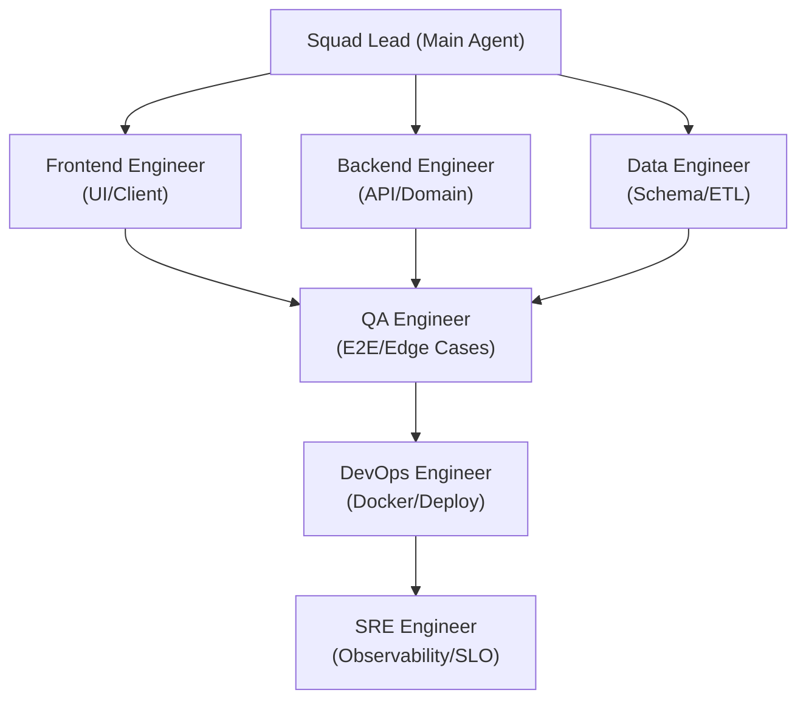

# dev-team-skills

> Andrej Karpathy의 엔지니어링 철학과 실용주의 시니어 개발 원칙을 기반으로 구축된 크로스 플랫폼(Windows/macOS) AI 코딩 에이전트 스킬 & 룰 모음 저장소입니다.  
> **Google Antigravity**, **Claude Code**, **OpenAI Codex**, **Cursor** 등 다양한 AI 코딩 환경에서 6개 전문 직무(Frontend, Backend, Data, QA, DevOps, SRE)로 에이전트 조직을 꾸리고 고품질 소프트웨어를 배포할 수 있도록 지원합니다.

---

## 🏛️ Constitution & Principles (기본 행동 헌법)

[`GEMINI.md`](./GEMINI.md) | [`CLAUDE.md`](./CLAUDE.md) | [`CODEX.md`](./CODEX.md) | [`AGENTS.md`](./AGENTS.md)

1. **Don't assume. Don't hide confusion. (추측 및 침묵 금지)**
   - 모호한 요구사항은 독단적으로 판단하지 않고 명확한 트레이드오프와 함께 사용자에게 확인받습니다.
2. **Minimum code & Standard library first. (Ponytail & YAGNI)**
   - "최고의 코드는 작성하지 않은 코드입니다." 외부 라이브러리 추가 전 언어 내장 표준 라이브러리와 네이티브 플랫폼 기능으로 해결합니다.
3. **Touch only what you must. Clean up your mess. (영역 한정 및 정리)**
   - 작업과 무관한 파일의 임의 수정(오지랖 리팩토링)을 금지하고 임시 파일은 작업 완료 전 깨끗이 정리합니다.
4. **Define success criteria. Loop until verified. (검증 완료 전 종료 금지)**
   - 완료 전 명확한 성공 검증 기준(DoD)을 수립하고 실제 빌드, 테스트, 헬스체크 명령어를 실행하여 증명합니다.
5. **High-Impact Communication & ADHD Optimization (소통 최적화)**
   - 서두의 미사여구를 배제하고 결론과 다음 행동(Lead with next action)을 가장 먼저 제시하며, 1단계 집중을 유도합니다.
6. **Cross-Platform Compatibility (Windows & macOS)**
   - Windows(PowerShell)와 macOS/Linux(Bash) 환경 모두를 지원하는 크로스 플랫폼 스크립트와 명령어를 제공합니다.

---

## 📦 스킬 모음 (Skills Collection)

| 스킬 이름 | 설명 | 주요 특징 |
| :--- | :--- | :--- |
| **`engineering-squad`** | 6인 에이전트 조직화 & 배포 오케스트레이션 | Frontend, Backend, Data, QA, DevOps, SRE 협업 및 5단계 배포 파이프라인 |
| **`code-review`** | ROI 중심의 역할별 디자인 패턴 코드 리뷰 | 3단계 심각도(🔴필수 / 🟡확인요청 / 🟢권장), SOLID 및 GoF 패턴 기반 대안 제시 |
| **`ponytail`** | 극단적 미니멀리즘 시니어 개발자 사고방식 | Standard Library First, 무분별한 래퍼/의존성 제거 |
| **`humanizer-kr`** | 자연스러운 한국어 테크니컬 라이팅 | AI 번역투, 이중 피동 제거, 의도 보존 윤문 |
| **`i-have-adhd`** | 인지 과부하 방지 및 초집중 워크플로우 | 결론 우선, 단일 액션 종결, 불필요 곁가지 차단 |

---

## 👥 Engineering Squad: 6개 전문 역할 및 검증 기준



| 역할 | 담당 영역 | 필수 검증 기준 (DoD) |
| :--- | :--- | :--- |
| **Squad Lead** | 요구사항 분해, 인터페이스/계약 정의, 에이전트 간 조율 | E2E 통합 시나리오 통과 |
| **Frontend** | UI 컴포넌트, 클라이언트 상태, API 연동, 브라우저 인터랙션 | 프로덕션 번들 빌드 (`npm run build`) 통과 |
| **Backend** | REST/GraphQL API, 도메인 로직, 인증, 에러 핸들링 | 단위/통합 테스트 통과 & API 응답 확인 |
| **Data Engineer** | DB 스키마(DDL), 마이그레이션(Up/Down), 쿼리 튜닝 | 마이그레이션 실행 & 롤백 테스트 검증 |
| **QA Engineer** | E2E 시나리오 테스트, 엣지 케이스/부정 테스트 | 테스트 스위트 100% 통과 |
| **DevOps** | Dockerfile/Compose, 환경 설정(`.env.example`), 배포 스크립트 | 컨테이너 빌드 & `/health` 200 확인 |
| **SRE** | SLO/SLI 지표, Observability(`/metrics`), 부하 테스트, 장애 복구 | 경량 부하 테스트 통과 & 메트릭 수집 검증 |

---

## 📝 Pull Request 템플릿 (카카오페이 스타일)

카카오페이 기술블로그의 *Slow PR, Fast Dev* 양식을 기반으로 한 [`.github/pull_request_template.md`](./.github/pull_request_template.md)가 포함되어 있습니다:

- `# 해결하려는 문제가 무엇인가요?`
- `# 왜 해야 하나요?`
- `# 어떻게 해결했나요?`
- `# 이 PR의 한계 & 트레이드오프`
- `# 기존 기능에 미치는 영향`
- `# Edge Case & 실패 시나리오`
- `# 검토한 대안과 선택 이유`
- `# 리뷰 포인트 (파일/영역별 Risk 🔴🟡🟢)`

---

## 💻 로컬 설치 및 적용 방법

### 1. Google Antigravity
```powershell
# [Windows] 전역 적용
Copy-Item GEMINI.md ~/.gemini/config/GEMINI.md
Copy-Item -Recurse skills/* ~/.gemini/config/skills/

# [macOS] 전역 적용
cp GEMINI.md ~/.gemini/config/GEMINI.md
cp -R skills/* ~/.gemini/config/skills/
```

### 2. Claude Code
프로젝트 루트에 `CLAUDE.md`를 배치하거나 스킬 폴더를 참조하도록 설정합니다.

### 3. OpenAI Codex
프로젝트 루트에 `CODEX.md`를 배치하여 코딩 에이전트 지침으로 활용합니다.

---

## 📜 License
MIT License
