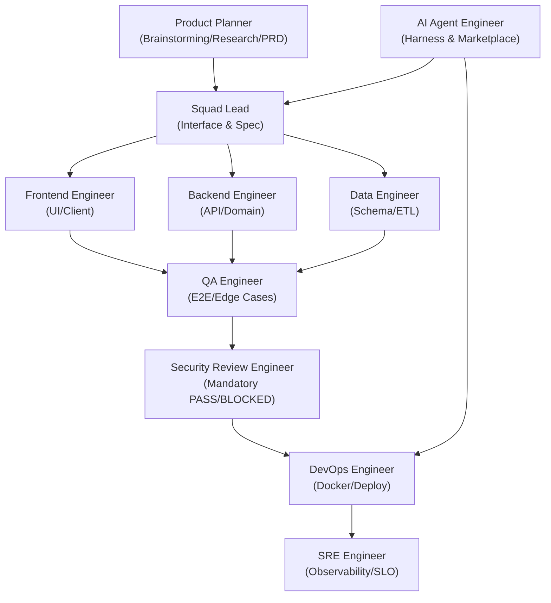

# dev-team-skills

[English](README.md) | [한국어](README_ko.md)

> Andrej Karpathy의 엔지니어링 철학과 실용주의 시니어 개발 원칙을 기반으로 구축된 크로스 플랫폼(Windows/macOS) AI 코딩 에이전트 스킬 & 룰 모음 저장소입니다.  
> **Google Antigravity**, **Claude Code**, **OpenAI Codex**, **Cursor** 등 다양한 AI 코딩 환경에서 14개 전문 직무(Product Planner, Creative Rookie, Product Marketing, Finance / FinOps, AI Agent Engineer, Frontend, Backend, Data, QA, Test Engineer, Security Review Engineer, Compliance Reviewer, DevOps, SRE)로 에이전트 조직을 꾸리고, **결정론적 하네스(Harness Engineering)**와 **3대 플랫폼 마켓플레이스 규격**을 통해 고품질 소프트웨어를 배포할 수 있도록 지원합니다.

---

## 🌟 왜 다른 스킬들보다 압도적으로 우수한가? (Why This Is Superior)

일반적인 프롬프트 모음이나 단편적인 에이전트 스킬들과 비교했을 때, `dev-team-skills`는 다음과 같은 명확한 비교 우위를 가집니다:

| 비교 항목 | 일반 에이전트 프롬프트 / 룰 모음 | **dev-team-skills** |
| :--- | :--- | :--- |
| **조직 커버리지** | 단일 코더 또는 단순 페어 프로그래밍에 한정 | **기획, 마케팅, 재무부터 AI 하네스, 개발, QA, 배포, 관측성까지 14개 역할 스쿼드 전 주기 커버** |
| **품질 보증 방식** | LLM의 "완료했습니다"라는 환각에 의존 | **결정론적 평가 하네스(`verify-harness`) 및 자가 치유(Self-healing) 루프** |
| **확장성 & 생태계** | 로컬 텍스트 복사 및 수동 설정 | **Antigravity, Claude Code, OpenAI Codex 3대 마켓플레이스 규격 100% 호환** |
| **실용주의 철학** | 불필요한 보일러플레이트 및 라이브러리 남용 | **Andrej Karpathy 원칙 & Ponytail (Standard Library First, YAGNI, 최소 코드)** |
| **협업 & 인지 부하** | 장황하고 피로한 AI 번역투 설명 | **카카오페이 스타일 PR 템플릿, 결론 우선(ADHD 최적화), 자연스러운 한국어(Humanizer)** |
| **크로스 플랫폼** | 특정 OS 명령어(Linux 전용 curl/bash)로 실패 빈번 | **Windows(PowerShell) & macOS/Linux(Bash) 동등 지원 및 CI 자동 검증** |

---

## 🏛️ Constitution & Principles (기본 행동 헌법)

[`GEMINI.md`](./GEMINI.md) | [`CLAUDE.md`](./CLAUDE.md) | [`CODEX.md`](./CODEX.md) | [`AGENTS.md`](./AGENTS.md)

1. **Don't assume. Don't hide confusion. (추측 및 침묵 금지)**
   - 모호한 요구사항은 독단적으로 판단하지 않고 명확한 트레이드오프와 함께 사용자에게 확인받습니다.
2. **Minimum code & Standard library first. (Ponytail & YAGNI)**
   - "최고의 코드는 작성하지 않은 코드입니다." 외부 라이브러리 추가 전 언어 내장 표준 라이브러리와 네이티브 플랫폼 기능으로 해결합니다.
3. **Touch only what you must. Clean up your mess. (영역 한정 및 정리)**
   - 작업과 무관한 파일의 임의 수정(오지랖 리팩토링)을 금지하고 임시 파일은 작업 완료 전 깨끗이 정리합니다.
4. **Define success criteria. Loop until verified. (검증 완료 전 종료 금지)**
   - 완료 전 명확한 성공 검증 기준(DoD)을 수립하고 실제 빌드, 테스트, 헬스체크 명령어를 실행하여 증명합니다.
5. **High-Impact Communication & ADHD Optimization (소통 최적화)**
   - 서두의 미사여구를 배제하고 결론과 다음 행동(Lead with next action)을 가장 먼저 제시하며, 1단계 집중을 유도합니다.
6. **Cross-Platform Compatibility (Windows & macOS)**
   - Windows(PowerShell)와 macOS/Linux(Bash) 환경 모두를 지원하는 크로스 플랫폼 스크립트와 명령어를 제공합니다.

---

## 📦 스킬 모음 (Skills Collection)

| 스킬 이름 | 설명 | 주요 특징 |
| :--- | :--- | :--- |
| **`engineering-squad`** | 14개 역할 기반 에이전트 조직화 & 6단계 배포 오케스트레이션 | 기획, 마케팅, 재무, AI 하네스, 개발, QA, 배포, SRE 협업 및 체계적 파이프라인 |
| **`brainstorming`** | 제품 기획, 문제 정의 및 체계적 아이디어 도출 | SCAMPER, HMW, RICE 점수표, 린 PRD 템플릿, `research` 서브에이전트 연계 |
| **`harness-engineering`** | AI 에이전트 평가 하네스 및 마켓플레이스 패키징 | 결정론적 오라클, 3대 Marketplace 규격(`plugin.json`, `.claude-plugin`, `.codex-plugin`), 자가 치유 루프 |
| **`code-review`** | ROI 중심의 역할별 디자인 패턴 코드 리뷰 | 3단계 심각도(🔴필수 / 🟡확인요청 / 🟢권장), 14개 직무 맞춤형 체크리스트 |
| **`ponytail`** | 극단적 미니멀리즘 시니어 개발자 사고방식 | Standard Library First, 무분별한 래퍼/의존성 제거 |
| **`humanizer`** | 영문 AI 문체 패턴 제거 (English) | Wikipedia AI 작성 징후 가이드 기반 작위적 수사, 삼분법, 과장, 로봇투 제거 |
| **`humanizer-kr`** | 자연스러운 한국어 테크니컬 라이팅 | AI 번역투, 이중 피동 제거, 의도 보존 윤문 |
| **`i-have-adhd`** | 인지 과부하 방지 및 초집중 워크플로우 | 결론 우선, 단일 액션 종결, 불필요 곁가지 차단 |

---

## 👥 Engineering Squad: 14개 전문 역할 및 검증 기준

14개 전문 역할·Lead와 별도로 **Humanizer Editor(쉬운 설명 담당)**가 최종 답변을 다듬습니다. 한국어는 `humanizer-kr`, 영어는 `humanizer`를 사용해 전문 용어를 쉬운 말·예시로 풀고 사실·위험·미검증 상태를 보존합니다. Lead 겸임 가능하며 별도 투표권 없이 기존 15표·8표 규칙을 유지합니다. [상세 계약](skills/engineering-squad/references/roles.md#humanizer-editor-최종-쉬운-설명-담당).



14개 전문 역할과 별도로 Squad Lead가 조율합니다. 필요한 역할을 활성화하되 QA Stage 3의 독립 보안 검수 엔지니어는 필수입니다.

| 역할 | 담당 영역 | 필수 검증 기준 (DoD) |
| :--- | :--- | :--- |
| **Product Planner** | 문제 정의, 브레인스토밍, 시장/기술 리서치, 린 PRD 명세 | 린 PRD(가설, MVP 스코프, 인수 조건) 작성 완료 |
| **Creative Rookie** | 합의의 가정에 반론, 최신 SNS 트렌드와 정기 아이디어 제안 | 출처·확인일·최소 실험을 담은 아이디어 카드와 찬반 근거 |
| **Product Marketing** | 한눈에 이해되는 가치·데모·출시 초안 | 대상·CTA·주장 근거·이해도 검토 |
| **Finance / FinOps** | 토큰·커뮤니케이션·개발·운영 비용 | 비용 상태·예산 편차·절감 대안 |
| **AI Agent Engineer** | 에이전트 평가 하네스(Eval) 구축, 도구 스키마, 마켓플레이스 패키징 | 하네스 검증 스크립트 실행 및 통과 리포트 |
| **Squad Lead** | 요구사항 분해, 인터페이스/계약 정의, 에이전트 간 조율 | E2E 통합 시나리오 통과 |
| **Frontend** | UI 컴포넌트, 클라이언트 상태, API 연동, 브라우저 인터랙션 | 프로덕션 번들 빌드 (`npm run build`) 통과 |
| **Backend** | REST/GraphQL API, 도메인 로직, 인증, 에러 핸들링 | 단위/통합 테스트 통과 & API 응답 확인 |
| **Data Engineer** | DB 스키마(DDL), 마이그레이션(Up/Down), 쿼리 튜닝 | 마이그레이션 실행 & 롤백 테스트 검증 |
| **QA Engineer** | E2E 시나리오 테스트, 엣지 케이스/부정 테스트 | 테스트 스위트 100% 통과 |
| **Test Engineer** | 프로젝트 실행 전 기대효과·수치화 가능성 및 중단·사람 보고 조건 필수 질문, 완료 기준·검증 누락 검토 | 사용자와 확인한 시작·중단 합의, AC-테스트-증거 검증표와 추가 의견 |
| **Security Review Engineer** | QA Stage 3 독립 보안·개인정보 검수 | 리비전별 PASS/BLOCKED, 배포 전 필수 |
| **Compliance Reviewer** | 국내·미국 IT 법령 및 보안 준수 검토 | 출처·적용 여부·발견사항·조치 기록 |
| **DevOps** | Dockerfile/Compose, 환경 설정(`.env.example`), 배포 스크립트 | 컨테이너 빌드 & `/health` 200 확인 |
| **SRE** | SLO/SLI 지표, Observability(`/metrics`), 부하 테스트, 장애 복구 | 경량 부하 테스트 통과 & 메트릭 수집 검증 |

보안 검수는 기능 QA와 함께 출시 선행조건입니다. [보안 계약](skills/engineering-squad/references/security-review.md)과 [스킬·사고 조사 근거](skills/engineering-squad/references/security-research.md)를 참조하십시오. 증거 부재나 미해결 출시 차단 사유가 있으면 배포를 중단합니다.

---

## 🛍️ 3대 플랫폼 마켓플레이스 패키징 규격 및 하네스 검증

본 저장소는 **Google Antigravity**, **Claude Code**, **OpenAI Codex** 3대 AI 코딩 에이전트 마켓플레이스 규격을 모두 충족하여, 단일 번들 형태로 손쉽게 검색·설치·배포할 수 있습니다:

| 플랫폼 | 마켓플레이스 매니페스트 / 카탈로그 규격 | 활성화 헌법 룰 & 스킬 경로 |
| :--- | :--- | :--- |
| **Google Antigravity** | `plugin.json` (메타데이터 및 추천 프롬프트) | `rules/AGENTS.md` & `skills/*/SKILL.md` |
| **Claude Code** | `.claude-plugin/marketplace.json` & `.claude-plugin/plugin.json` | `CLAUDE.md` & `skills/*/SKILL.md` |
| **OpenAI Codex** | `.codex-plugin/plugin.json` 및 `plugin.json` | `CODEX.md` / `AGENTS.md` & `skills/*/SKILL.md` |

### 🔍 결정론적 하네스 무결성 검증 (Cross-Platform)

4대 매니페스트 유효성, 전체 스킬 Frontmatter, 그리고 5대 헌법 룰(`GEMINI.md`, `CLAUDE.md`, `CODEX.md`, `AGENTS.md`, `rules/AGENTS.md`)의 SHA-256 동기화 상태를 로컬 및 CI 환경에서 엄격하게 검증합니다:

```bash
# Windows (PowerShell)
.\scripts\verify-harness.ps1

# macOS / Linux (Bash)
./scripts/verify-harness.sh
```

---

## 💻 플랫폼별 마켓플레이스 설치 및 사용 가이드

### 1. Google Antigravity

#### 방법 A: Marketplace 카탈로그 또는 UI로 추가 (권장)
- Antigravity IDE 상단 메뉴의 **Customizations** > **Marketplace** 진입
- 검색창에 `dev-team-skills`를 검색한 뒤 **[Install]** 클릭
- 또는 채팅창 내 플러그인 카드를 통해 원클릭 설치:
  ```markdown
  <plugin-card catalog-id="dev-team-skills"></plugin-card>
  ```

#### 방법 B: 로컬 전역 플러그인 디렉터리에 설치
```bash
# Windows (PowerShell)
git clone https://github.com/DongJinNam/dev-team-skills.git ~/.gemini/config/plugins/dev-team-skills

# macOS / Linux (Bash)
git clone https://github.com/DongJinNam/dev-team-skills.git ~/.gemini/config/plugins/dev-team-skills
```

#### 방법 C: 프로젝트 워크스페이스 전용 플러그인
- 작업 프로젝트 루트에 `.agents/plugins/dev-team-skills` 경로로 클론하거나 `.agents/plugins.json`에 선언하여 팀원들과 Git으로 공유할 수 있습니다.

---

### 2. Claude Code

#### 방법 A: Claude Code 마켓플레이스 명령어로 등록 및 설치 (공식 권장)
Claude Code CLI 또는 대화형 프롬프트에서 원격 마켓플레이스로 등록하고 즉시 설치합니다:

```bash
# 1. GitHub 저장소를 Claude Code 마켓플레이스로 추가
/plugin marketplace add DongJinNam/dev-team-skills

# 2. dev-team-skills 플러그인 원클릭 설치
/plugin install dev-team-skills
```

> **CLI 직접 실행 시**:
> ```bash
> claude plugin marketplace add DongJinNam/dev-team-skills
> claude plugin install dev-team-skills
> ```

#### 방법 B: 플러그인 유효성 로컬 검증
```bash
claude plugin validate
```

#### 방법 C: 로컬 프로젝트 메모리 연동
- 대상 프로젝트 루트에 `CLAUDE.md`를 심어 헌법 규칙을 주입하고, `skills/` 디렉터리의 직무 가이드를 호출합니다.

---

### 3. OpenAI Codex

#### 방법 A: Codex CLI 마켓플레이스 추가 (권장)
```bash
# 1. 마켓플레이스 카탈로그 등록
codex plugin marketplace add DongJinNam/dev-team-skills --ref main

# 2. 플러그인 설치
codex plugin install dev-team-skills
```

#### 방법 B: Codex CLI 대화형 관리자
- Codex CLI 프롬프트에서 `/plugins`를 입력하여 인터랙티브 플러그인 매니저를 열고 `dev-team-skills`를 검색하여 활성화합니다.

#### 방법 C: 프로젝트 코딩 에이전트 지침 연동
- 프로젝트 루트에 `CODEX.md` 또는 `AGENTS.md`를 배치하면 코딩 에이전트 세션 시작 시 헌법과 14개 직무 가이드라인이 자동으로 컨텍스트에 주입됩니다.

---

## 📝 Pull Request 템플릿 (카카오페이 스타일)

카카오페이 기술블로그 [「PR을 더 느리게 만들기 위한 고민 (Slow PR, Fast Dev)」](https://tech.kakaopay.com/post/kakaopayins-slow-pr-fast-dev/)의 실천 철학을 기반으로 한 [`.github/pull_request_template.md`](./.github/pull_request_template.md)가 포함되어 있습니다:

- `# 해결하려는 문제가 무엇인가요?`
- `# 왜 해야 하나요?`
- `# 어떻게 해결했나요?`
- `# 이 PR의 한계 & 트레이드오프`
- `# 기존 기능에 미치는 영향`
- `# Edge Case & 실패 시나리오`
- `# 검토한 대안과 선택 이유`
- `# 리뷰 포인트 (파일/영역별 Risk 🔴🟡🟢)`

---

### Creative Rookie & 전 역할 다수결

신입은 기획 시작·진행 프로젝트 주간 회고·출시 메시지 확정 전에 SNS 근거를 확인하고 새 아이디어·반론·최소 실험을 제안합니다. 의사결정 토론은 비활성 역할도 포함해 14개 전문 역할과 Lead가 각 1표(총 15표)를 가지며 찬성 8표가 모이면 전원 투표 완료를 기다리지 않고 즉시 가결합니다. 어느 쪽도 8표가 없으면 PENDING입니다. 사용자가 만족하지 않아 근거를 제시하며 재투표를 요청하면 이전 표를 이월하지 않고 새로 투표합니다. 필수 보안·컴플라이언스 검수는 표결로 면제하지 않습니다. [상세 역할·투표 규칙](skills/engineering-squad/references/roles.md).

## 📜 License
MIT License
