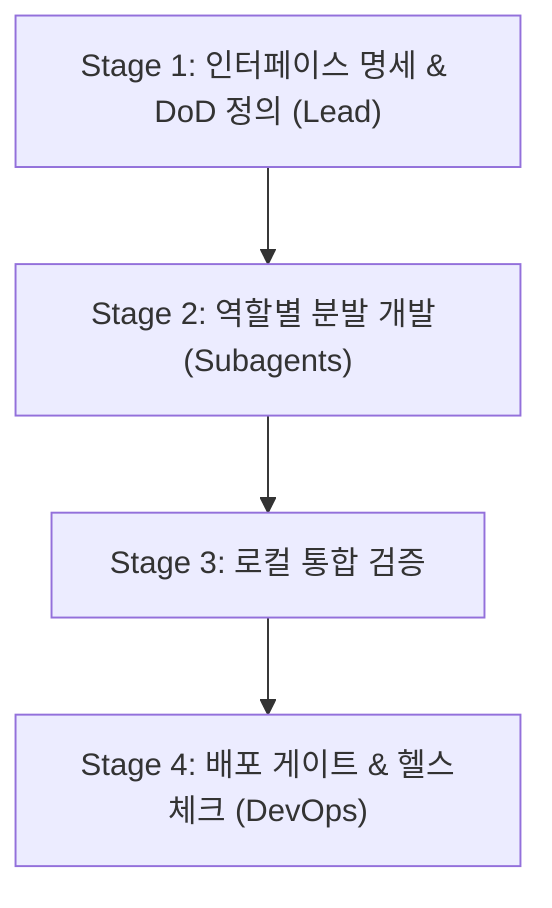

# Engineering Squad & Service Deployment Workflow

이 스킬은 프론트엔드, 백엔드, 데이터 엔지니어, DevOps 엔지니어라는 4개 전문 역할을 서브에이전트 조직으로 구성하여 소프트웨어를 개발하고 안정적으로 서비스를 배포할 때 사용하는 표준 실행 지침입니다.

---

## 1. Squad Roles & Responsibilities

| 역할 | 담당 영역 | 검증 기준 (DoD) |
| :--- | :--- | :--- |
| **Squad Lead (Main Agent)** | 요구사항 분해, 인터페이스/계약 정의, 서브에이전트 조율, Karpathy 4원칙 준수 감독 | 엔드투엔드 통합 시나리오 통과 |
| **Frontend Engineer** | UI 컴포넌트, 클라이언트 상태 관리, API 연동, 브라우저 인터랙션 | 프로덕션 번들 빌드 (`npm run build`) 통과 |
| **Backend Engineer** | REST/GraphQL API, 도메인 비즈니스 로직, 인증, 에러 핸들링 | 단위/통합 테스트 통과 & API 응답 검증 |
| **Data Engineer** | DB 스키마(DDL), 마이그레이션(Up/Down), 쿼리 최적화, 시드 데이터 | 마이그레이션 실행 & 롤백 테스트 검증 |
| **DevOps Engineer** | Dockerfile/Compose, 환경 설정(`.env.example`), 배포 스크립트, 무중단 배포 | 컨테이너 빌드 & `/health` 200 응답 확인 |

*세부 프롬프트 및 직무별 지침은 [roles.md](./references/roles.md)를 참조하십시오.*

---

## 2. 4-Stage Execution Pipeline

### Stage 1: 명세 확정 및 작업 분해 (Lead)
1. **API & 스키마 계약 수립**: 엔드포인트 URL, 요청/응답 JSON 페이로드, DB 엔티티 관계를 먼저 문서화합니다.
2. **환경 변수 정의**: 필요한 설정 목록(`.env.example`)을 도출합니다.
3. **배포 검증 기준 수립**: 작업 종료를 입증할 구체적인 명령어(예: `curl -f http://localhost:8080/health`)를 지정합니다.

### Stage 2: 역할별 서브에이전트 위임 (Dispatch)
의존 관계에 따라 작업을 분배합니다:
1. **Data Engineer**: DB 스키마 및 마이그레이션 스크립트 작성.
2. **Backend Engineer**: 정의된 스키마와 API 스펙을 기반으로 엔드포인트 구현.
3. **Frontend Engineer**: 백엔드 API 계약에 맞춰 UI 컴포넌트 및 클라이언트 로직 구현.
4. **DevOps Engineer**: 컨테이너화(Dockerfile, Compose) 및 배포 파이프라인 스크립트 작성.

> [!IMPORTANT]
> 서브에이전트 호출 시 항상 `invoke_subagent` 도구를 사용하며, [roles.md](./references/roles.md)에 기술된 해당 직무의 원칙과 Karpathy 4원칙을 프롬프트에 명시하십시오.

### Stage 3: 로컬 통합 검증 (Integration Verification)
모든 컴포넌트가 연동되었는지 확인합니다:
- 프론트엔드 빌드 오류 점검 (`npm run build`, `pnpm build` 등)
- 백엔드 서버 기동 및 핵심 엔드포인트 테스트 (cURL 또는 테스트 러너)
- DB 마이그레이션이 정상 적용되는지 확인
- 작업 중 생성된 임시 파일/테스트 흔적 정리

### Stage 4: 배포 게이트 & 헬스체크 (Deployment Gate)
- [deployment-gate.md](./references/deployment-gate.md)의 체크리스트를 순차적으로 통과해야 합니다.
- DevOps 서브에이전트 또는 스크립트를 통해 서비스를 구동/배포합니다.
- 실제 헬스체크 요청을 실행하여 정상 응답(HTTP 200)을 직접 검증한 후 최종 보고합니다.
