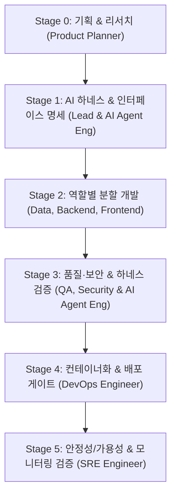

# Engineering Squad & Service Deployment Workflow

이 스킬은 **기획자(Product Planner)**, **Product Marketing**, **Finance / FinOps**, **AI 에이전트 엔지니어(AI Agent Engineer)**, **프론트엔드**, **백엔드**, **데이터 엔지니어**, **QA 엔지니어**, **보안 검수 엔지니어(Security Review Engineer)**, **DevOps 엔지니어**, **SRE(Site Reliability Engineer)**라는 11개 전문 역할을 서브에이전트 조직으로 구성하여 소프트웨어를 기획·개발하고, 무결성을 검증하며, 고가용성으로 안정 배포할 때 사용하는 표준 실행 지침입니다.

---

## 1. Squad Roles & Responsibilities

11개 전문 역할과 별도로 Squad Lead가 조율합니다. 필요한 역할을 활성화하되 Stage 3의 보안 검수 엔지니어는 필수이며 구현자와 별도 검토자로 구성합니다.

| 역할 | 담당 영역 | 검증 기준 (DoD) |
| :--- | :--- | :--- |
| **Product Planner** | 문제 정의, 브레인스토밍, 시장/기술 리서치, 린 PRD & 유저 스토리 명세 | PRD(가설, MVP 스코프, 인수 조건) 작성 완료 |
| **Product Marketing** | 가치 전달, 정보 위계, 데모·출시 메시지 | 대상·가치·CTA와 주장별 근거, 이해도 검토 완료 |
| **Finance / FinOps** | 토큰·협업·개발·운영 비용 및 예산 편차 | 실측/추정/미확인 비용표와 절감 대안·품질 영향 보고 |
| **AI Agent Engineer** | 에이전트 평가 하네스(Eval) 구축, 도구 스키마 검증, 3rd-party Marketplace 패키징 | 하네스 검증 스크립트 실행 및 통과 리포트 |
| **Squad Lead (Main Agent)** | 요구사항 분해, 인터페이스/계약 정의, 서브에이전트 조율, Karpathy 4원칙 준수 감독 | 엔드투엔드 통합 시나리오 통과 |
| **Frontend Engineer** | UI 컴포넌트, 클라이언트 상태 관리, API 연동, 브라우저 인터랙션 | 프로덕션 번들 빌드 (`npm run build`) 통과 |
| **Backend Engineer** | REST/GraphQL API, 도메인 비즈니스 로직, 인증, 에러 핸들링 | 단위/통합 테스트 통과 & API 응답 검증 |
| **Data Engineer** | DB 스키마(DDL), 마이그레이션(Up/Down), 쿼리 최적화, 시드 데이터 | 마이그레이션 실행 & 롤백 테스트 검증 |
| **QA Engineer** | E2E 시나리오 테스트, 엣지 케이스/부정 테스트, 회귀 테스트, 품질 게이트 검증 | 자동화 테스트 스위트 100% 통과 |
| **Security Review Engineer** | 위협 모델, 인증/인가·개인정보·시크릿, 의존성·설정 보안 검수 | 검토 리비전에 대한 독립 PASS/BLOCKED 보고서, 미해결 출시 차단 사유 없음 |
| **DevOps Engineer** | Dockerfile/Compose, 환경 설정(`.env.example`), 배포 스크립트, 무중단 배포 | 컨테이너 빌드 & `/health` 200 응답 확인 |
| **SRE Engineer** | SLO/SLI 지표 정의, Observability(메트릭/로그/트레이스), 장애 복구/서킷브레이커, 부하 테스트 | 임계치 부하 테스트 통과 & 모니터링 메트릭 검증 |

*세부 프롬프트 및 직무별 지침은 [roles.md](./engineering-squad/references/roles.md)를 참조하십시오.*

---

### 역할 활성화 및 인계
- 11개 역할은 역량 목록이며 항상 11명을 호출하라는 뜻이 아닙니다. 작은 수정은 Lead가 관점을 겸하고, 독립 산출물이나 비용 위험이 있을 때만 위임합니다.
- Stage 3에서는 독립 Security Review Engineer를 항상 활성화합니다. 별도 검토자가 없으면 BLOCKED로 기록하고 Lead/구현자의 자기 승인으로 대체하지 않습니다. 작은 범위·예산 압박으로 생략하지 않습니다.
- Stage 0: Planner는 출처·날짜·성숙도·적용 가치를 담은 트렌드 근거를 PRD에 기록합니다. Marketing은 대상·가치·CTA를, Finance는 예산·최소 역할 구성·비용 기준선을 정의합니다.
- Stage 1–2: Lead는 역할별 범위·입력·산출물·검증 기준을 명시합니다. Finance는 추가 위임과 범위 변경의 증분 비용을 점검합니다. 전체 대화 대신 결정·근거·미해결 사항과 파일 경로만 인계합니다.
- Stage 3: Marketing은 검증된 결과로 이해도와 주장 근거를 검토하고, Finance는 비용 편차와 중복 토론을 점검합니다. 기본 토론은 제안 1회와 반론 1회 후 Lead가 결정합니다. 추가 라운드는 새 근거와 기대 가치를 기록합니다.
- Stage 4–5: Marketing은 실제 배포 상태를 반영한 출시 초안을, Finance는 최종 비용표와 운영비 전망을 전달합니다. 외부 게시 권한은 별도로 확인합니다.
- 상세 산출물·계측 부재·예산 초과 처리 기준은 [roles.md](./engineering-squad/references/roles.md)의 9–10절을 적용합니다.

보안은 출시 선행조건입니다. Planner와 Marketing은 [security-research.md](./engineering-squad/references/security-research.md)에 사고·채택 근거와 확인일을 유지하며 인기를 안전성의 증거로 취급하지 않습니다.

## 2. 6-Stage Execution Pipeline

### Stage 0: 기획 & 리서치 (Product Planner)
1. **문제 정의 및 아이디어 발산**: 사용자의 핵심 문제를 정의하고 `brainstorming` 스킬을 활용하여 SCAMPER 및 HMW 발산.
2. **리서치 연계**: 내장 `research` 서브에이전트 또는 웹 리서치로 유사 서비스 및 기술 스택 벤치마킹.
3. **린 PRD 작성**: RICE 점수표와 MoSCoW를 바탕으로 핵심 가설, MVP 스코프, 유저 스토리 및 Given-When-Then 인수 기준(AC) 확정.

### Stage 1: AI 하네스 & 인터페이스 명세 확정 (Lead & AI Agent Engineer)
1. **API & 스키마 계약 수립**: 엔드포인트 URL, 요청/응답 JSON 페이로드, DB 엔티티 관계를 먼저 문서화합니다.
2. **AI 에이전트 하네스 설계**: 서브에이전트 작업 검증을 위한 결정론적 평가 스크립트(`verify-harness.ps1`, `verify-harness.sh`) 및 DoD 기준 확정.
3. **품질·보안 및 신뢰성 지표 수립**: Security는 구현 전에 데이터·신뢰 경계, 적용 검사, 출시 차단 기준을 정의합니다. 필수 테스트 커버리지, SLO(예: 가용성 99.9%, p95 지연 시간 200ms 이하)를 설정합니다.

### Stage 2: 기능 개발 분할 위임 (Dispatch)
1. **Data Engineer**: DB 스키마 및 양방향 마이그레이션(Up/Down), 시드 데이터 작성.
2. **Backend Engineer**: 정의된 스펙 기반 엔드포인트 구현 및 비즈니스 로직 작성.
3. **Frontend Engineer**: 백엔드 API 계약에 맞춰 UI 컴포넌트 및 클라이언트 상태 로직 구현.

### Stage 3: 품질·보안 & 하네스 검증 (QA, Security & AI Agent Engineer)
1. **QA Engineer**: 주요 사용자 여정에 대한 E2E 테스트 및 경계값/오류 상황(Negative Test) 검증.
2. **AI Agent Engineer**: 에이전트 도구 호출 무결성 및 3rd-party Marketplace 규격 유효성 검사 수행.
3. **Security Review Engineer (필수)**: [security-review.md](./engineering-squad/references/security-review.md)를 적용하여 최신 보안 이슈·프로젝트 적용 여부를 출처·날짜와 함께 확인하고 리비전별 PASS/BLOCKED 보고서를 QA 결과에 첨부합니다. 기능 QA 통과만으로 Stage 3을 통과하지 않습니다.
4. **자가 치유 루프**: 발견된 결함은 진단 정보와 함께 즉시 담당 에이전트에게 피드백하여 해결 루프 가동. 수정 후 영향받는 테스트와 독립 보안 검수를 다시 수행하고 QA와 보안이 모두 통과해야 Stage 4로 진행합니다.

### Stage 4: 컨테이너화 및 배포 (DevOps Engineer)
- 멀티스테이지 Dockerfile, docker-compose.yml 및 배포 스크립트 작성.
- [deployment-gate.md](./engineering-squad/references/deployment-gate.md)의 배포 체크리스트 통과 후 배포합니다. Stage 4 진입 전에 보안 PASS가 필요하며 배포 완료 선언 시점까지 미루지 않습니다.

### Stage 5: 가용성 & 모니터링 검증 (SRE Engineer)
- 헬스체크(`/health`) 및 메트릭스(`/metrics`) 엔드포인트 활성화 검증.
- 경량 부하 테스트를 수행하여 트래픽 인입 시 서비스 생존 및 에러율 0% 입증.
- Graceful Shutdown 및 장애 시 복구 루틴 점검.
