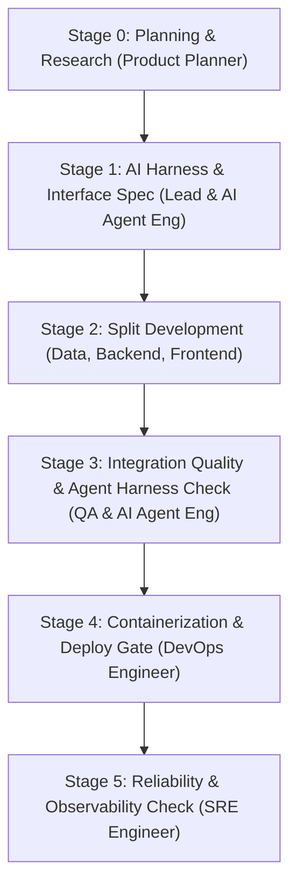

# Engineering Squad & Service Deployment Workflow

This skill is the standard execution guide for building, testing, and deploying software. It organizes an AI agent team into 8 specialized roles: **Product Planner**, **AI Agent Engineer**, **Frontend**, **Backend**, **Data Engineer**, **QA Engineer**, **DevOps Engineer**, and **SRE (Site Reliability Engineer)**.

---

## 1. Squad Roles & Responsibilities

| Role | Scope | Required Definition of Done (DoD) |
| :--- | :--- | :--- |
| **Product Planner** | Problem definition, brainstorming, market research, Lean PRD & user stories | Lean PRD complete with hypothesis, MVP scope, and acceptance criteria |
| **AI Agent Engineer** | Agent eval harness, tool schema checks, 3rd-party marketplace packaging | Verification harness script passes with full green report |
| **Squad Lead (Main Agent)** | Task breakdown, interface contracts, agent coordination, enforces Karpathy principles | E2E integration scenario passes |
| **Frontend Engineer** | UI components, client state, API calls, browser UI | Production build passes (`npm run build`) with zero type errors |
| **Backend Engineer** | REST/GraphQL APIs, domain business logic, auth, error handling | Unit & integration tests pass, API endpoints respond correctly |
| **Data Engineer** | DB schemas (DDL), migrations (Up/Down), query tuning, seed data | Migration and rollback scripts execute and succeed |
| **QA Engineer** | E2E testing, negative test cases, corner cases, regression tests | 100% pass on automated test suite |
| **DevOps Engineer** | Dockerfile/Compose, environment configs (`.env.example`), deploy scripts | Container builds cleanly, `/health` returns HTTP 200 |
| **SRE Engineer** | SLO/SLI metrics, observability (metrics/logs/traces), circuit breakers, load testing | Light load test passes, metrics collection verified |

*For detailed prompts and role instructions, see [roles_en.md](./references/roles_en.md).*

---

## 2. 6-Stage Execution Pipeline

### Stage 0: Planning & Research (Product Planner)
1. **Define the problem & brainstorm**: Find the user's core problem. Use the `brainstorming` skill with SCAMPER and HMW exercises.
2. **Research**: Benchmarks similar products and tech stacks using the `research` subagent or web search.
3. **Write a Lean PRD**: Use RICE scoring and MoSCoW prioritization to set key hypotheses, MVP scope, user stories, and Given-When-Then acceptance criteria (AC).

### Stage 1: AI Harness & Interface Contracts (Lead & AI Agent Engineer)
1. **Define API & schema contracts**: Document endpoint URLs, request/response JSON payloads, and DB models before writing code.
2. **Build the AI evaluation harness**: Set up deterministic test scripts (`verify-harness.ps1`, `verify-harness.sh`) and DoD criteria for subagents.
3. **Set quality and reliability goals**: Define required test coverage and SLOs (e.g. 99.9% uptime, p95 latency under 200ms).

### Stage 2: Split Development by Role (Dispatch)
1. **Data Engineer**: Creates DB schemas, two-way migrations (Up/Down), and seed data.
2. **Backend Engineer**: Builds endpoints and domain logic based on the agreed spec.
3. **Frontend Engineer**: Builds UI components and state logic matching the backend API contract.

### Stage 3: Integration Quality & Agent Harness Verification (QA & AI Agent Engineer)
1. **QA Engineer**: Runs E2E tests for main user journeys, boundary checks, and error cases (negative tests).
2. **AI Agent Engineer**: Validates agent tool calls and verifies marketplace manifests.
3. **Self-Healing Loop**: Feeds test errors directly back to the responsible agent for quick fixes.

### Stage 4: Containerization & Deployment Gate (DevOps Engineer)
- Writes multi-stage Dockerfile, docker-compose.yml, and deployment scripts.
- Passes all checklist items in [deployment-gate_en.md](./references/deployment-gate_en.md) before starting services.

### Stage 5: Reliability & Observability Verification (SRE Engineer)
- Checks health check (`/health`) and metrics (`/metrics`) endpoints.
- Runs a light load test to prove the service stays alive with 0% error rate under traffic.
- Verifies graceful shutdown and recovery routines.
