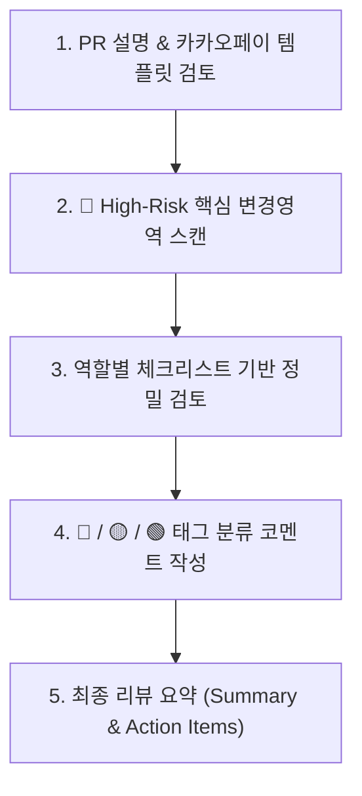

# High-ROI Code Review Workflow

이 스킬은 **"Input 대비 Output(ROI)이 가장 큰 핵심 문제"**에 집중하여, 불필요한 사소한 트집(Nitpicking)을 배제하고 소프트웨어의 견고함과 유지보수성을 극대화하는 코드 리뷰를 수행합니다.

---

## 1. 3단계 리뷰 심각도 분류 체계 (Severity Rubric)

모든 리뷰 코멘트에는 명확한 머지 기준을 위해 심각도 태그를 부여합니다:

| 등급 | 레벨 | 설명 | 머지 조건 |
| :---: | :--- | :--- | :--- |
| 🔴 | **[필수 / Must Fix]** | 버그, 데이터 유실 위험, 보안 취약점, 메모리 누수, 심각한 성능 저하, 롤백 불가능한 스키마 변경 | **반드시 수정 후 머지 가능** |
| 🟡 | **[확인 요청 / Inquire & Verify]** | 설계 의도 확인 필요, 사이드 이펙트 우려, 불명확한 에지 케이스 처리, 트레이드오프 검토 | **작성자의 확인 및 답변 필수** |
| 🟢 | **[권장 / Suggestion]** | 가독성 개선, 사소한 리팩토링, 디자인 패턴 적용 권장, 미세 최적화 | **작성자 판단 하에 선택적 반영 (머지 블로커 아님)** |

*상세한 판단 기준 및 디자인 패턴 가이드는 [review-rubric.md](./references/review-rubric.md)를 참조하십시오.*

---

## 2. 리뷰 핵심 원칙 (Core Philosophy)

1. **High ROI First (가치 중심)**:
   - 줄바꿈이나 띄어쓰기 같은 스타일은 린터/포매터에 맡기고, **비즈니스 로직 결함, 동시성 이슈, 경계값 오류, 장애 전파 가능성** 등 비즈니스와 시스템에 치명적인 영향을 주는 영역에 리뷰 에너지를 80% 이상 집중합니다.
2. **Design Pattern & SOLID Grounded (설계 원칙 근거)**:
   - "그냥 이렇게 바꾸는 게 좋아 보입니다" 식의 주관적 의견을 배제하고, **단일 책임 원칙(SRP), 개방-폐쇄 원칙(OCP), 결합도 완화, 전략/팩토리/어댑터 패턴** 등 명확한 아키텍처 원칙에 기반하여 대안을 제시합니다.
3. **Role-Tailored Perspective (직무 맞춤형)**:
   - 변경된 코드 영역에 따라 해당 전문 역할(Product Planner, AI Agent Engineer, Frontend, Backend, Data, QA, DevOps, SRE)의 관점에서 특화된 질문을 던집니다. ([role-checklists.md](./references/role-checklists.md) 참조)

---

## 3. 코드 리뷰 수행 절차

1. **맥락 파악**: PR 템플릿의 `해결하려는 문제`, `트레이드오프`, `위험도(🔴🟡🟢)`를 먼저 읽고 변경 의도를 파악합니다.
2. **위험 영역 우선 점검**: 트랜잭션, 인증/인가, 외부 API 통신, 상태 전이 등 핵심 비즈니스 로직을 우선 검토합니다.
3. **역할별 특화 점검**:
   - 프론트엔드: 불필요 렌더링, 클라이언트 번들 크기, 에러 바운더리
   - 백엔드: N+1 쿼리, 동시성 락, 예외 격리
   - 데이터: 인덱스 활용 여부, Up/Down 마이그레이션 안전성
   - QA: 엣지 케이스 및 실패 시나리오 테스트 여부
   - DevOps/SRE: 환경변수 노출, 컨테이너 리소스 제한, 헬스체크 및 메트릭
4. **대안 제시**: 문제를 지적할 때는 반드시 **"왜 문제인지"**와 **"최소 코드로 해결하는 대안(Alternative Code Snippet)"**을 함께 제공합니다.
