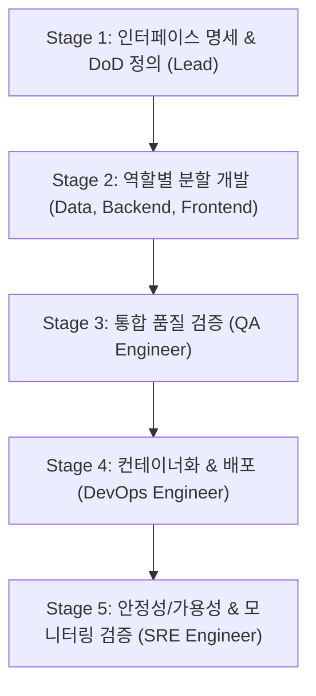

# Engineering Squad & Service Deployment Workflow

이 스킬은 프론트엔드, 백엔드, 데이터 엔지니어, QA 엔지니어, DevOps 엔지니어, SRE(Site Reliability Engineer)라는 6개 전문 역할을 서브에이전트 조직으로 구성하여 소프트웨어를 개발하고, 무결성을 검증하며, 고가용성으로 안정 배포할 때 사용하는 표준 실행 지침입니다.

---

## 1. Squad Roles & Responsibilities

| 역할 | 담당 영역 | 검증 기준 (DoD) |
| :--- | :--- | :--- |
| **Squad Lead (Main Agent)** | 요구사항 분해, 인터페이스/계약 정의, 서브에이전트 조율, Karpathy 4원칙 준수 감독 | 엔드투엔드 통합 시나리오 통과 |
| **Frontend Engineer** | UI 컴포넌트, 클라이언트 상태 관리, API 연동, 브라우저 인터랙션 | 프로덕션 번들 빌드 (`npm run build`) 통과 |
| **Backend Engineer** | REST/GraphQL API, 도메인 비즈니스 로직, 인증, 에러 핸들링 | 단위/통합 테스트 통과 & API 응답 검증 |
| **Data Engineer** | DB 스키마(DDL), 마이그레이션(Up/Down), 쿼리 최적화, 시드 데이터 | 마이그레이션 실행 & 롤백 테스트 검증 |
| **QA Engineer** | E2E 시나리오 테스트, 엣지 케이스/부정 테스트, 회귀 테스트, 품질 게이트 검증 | 자동화 테스트 스위트 100% 통과 |
| **DevOps Engineer** | Dockerfile/Compose, 환경 설정(`.env.example`), 배포 스크립트, 무중단 배포 | 컨테이너 빌드 & `/health` 200 응답 확인 |
| **SRE Engineer** | SLO/SLI 지표 정의, Observability(메트릭/로그/트레이스), 장애 복구/서킷브레이커, 부하 테스트 | 임계치 부하 테스트 통과 & 모니터링 메트릭 검증 |

*세부 프롬프트 및 직무별 지침은 [roles.md](./references/roles.md)를 참조하십시오.*

---

## 2. 5-Stage Execution Pipeline

### Stage 1: 명세 확정 및 작업 분해 (Lead)
1. **API & 스키마 계약 수립**: 엔드포인트 URL, 요청/응답 JSON 페이로드, DB 엔티티 관계를 먼저 문서화합니다.
2. **품질 및 신뢰성 지표 수립**: 필수 테스트 커버리지, SLO(예: 가용성 99.9%, p95 지연 시간 200ms 이하)를 설정합니다.
3. **배포 검증 기준(DoD) 수립**: 작업 종료를 입증할 구체적인 명령어(예: `curl -f http://localhost:8080/health`)를 지정합니다.

### Stage 2: 기능 개발 분할 위임 (Dispatch)
1. **Data Engineer**: DB 스키마 및 양방향 마이그레이션(Up/Down), 시드 데이터 작성.
2. **Backend Engineer**: 정의된 스펙 기반 엔드포인트 구현 및 비즈니스 로직 작성.
3. **Frontend Engineer**: 백엔드 API 계약에 맞춰 UI 컴포넌트 및 클라이언트 상태 로직 구현.

### Stage 3: 통합 품질 검증 (QA Engineer)
- 주요 사용자 여정에 대한 E2E 테스트 및 경계값/오류 상황(Negative Test) 검증.
- 발견된 결함은 즉시 재현 스크립트와 함께 Frontend/Backend 에이전트에 피드백하여 해결 루프 가동.

### Stage 4: 컨테이너화 및 배포 (DevOps Engineer)
- 멀티스테이지 Dockerfile, docker-compose.yml 및 배포 스크립트 작성.
- [deployment-gate.md](./references/deployment-gate.md)의 배포 체크리스트 통과 후 서비스 기동.

### Stage 5: 가용성 & 모니터링 검증 (SRE Engineer)
- 헬스체크(`/health`) 및 메트릭스(`/metrics`) 엔드포인트 활성화 검증.
- 경량 부하 테스트를 수행하여 트래픽 인입 시 서비스 생존 및 에러율 0% 입증.
- Graceful Shutdown 및 장애 시 복구 루틴 점검.
