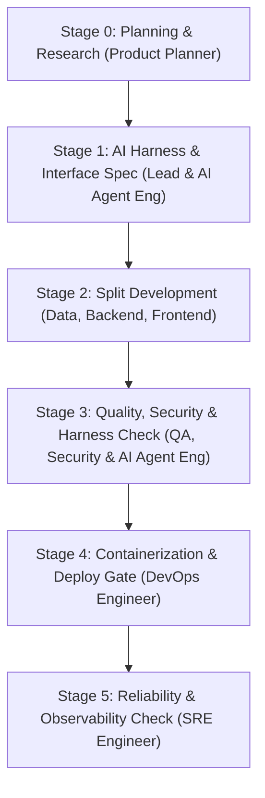

# Engineering Squad & Service Deployment Workflow

This skill is the standard execution guide for building, testing, and deploying software. It organizes an AI agent team into 11 specialized roles: **Product Planner**, **Product Marketing**, **Finance / FinOps**, **AI Agent Engineer**, **Frontend**, **Backend**, **Data Engineer**, **QA Engineer**, **Security Review Engineer**, **DevOps Engineer**, and **SRE (Site Reliability Engineer)**.

---

## 1. Squad Roles & Responsibilities

The eleven specialist roles are coordinated by the separate Squad Lead. Activate roles as needed; Security Review Engineer is mandatory at Stage 3 and must be a reviewer separate from the implementer.

| Role | Scope | Required Definition of Done (DoD) |
| :--- | :--- | :--- |
| **Product Planner** | Problem definition, brainstorming, market research, Lean PRD & user stories | Lean PRD complete with hypothesis, MVP scope, and acceptance criteria |
| **Product Marketing** | Value communication, information hierarchy, demos and launch messaging | Audience/value/CTA, evidence per claim, comprehension review |
| **Finance / FinOps** | Token, coordination, development and operating costs; budget variance | Measured/estimated/unknown cost table, savings options and quality impact |
| **AI Agent Engineer** | Agent eval harness, tool schema checks, 3rd-party marketplace packaging | Verification harness script passes with full green report |
| **Squad Lead (Main Agent)** | Task breakdown, interface contracts, agent coordination, enforces Karpathy principles | E2E integration scenario passes |
| **Frontend Engineer** | UI components, client state, API calls, browser UI | Production build passes (`npm run build`) with zero type errors |
| **Backend Engineer** | REST/GraphQL APIs, domain business logic, auth, error handling | Unit & integration tests pass, API endpoints respond correctly |
| **Data Engineer** | DB schemas (DDL), migrations (Up/Down), query tuning, seed data | Migration and rollback scripts execute and succeed |
| **QA Engineer** | E2E testing, negative test cases, corner cases, regression tests | 100% pass on automated test suite |
| **Security Review Engineer** | Threat modeling, authorization/privacy/secrets, dependency and configuration review | Independent PASS/BLOCKED report for the reviewed revision; no unresolved release blockers |
| **DevOps Engineer** | Dockerfile/Compose, environment configs (`.env.example`), deploy scripts | Container builds cleanly, `/health` returns HTTP 200 |
| **SRE Engineer** | SLO/SLI metrics, observability (metrics/logs/traces), circuit breakers, load testing | Light load test passes, metrics collection verified |

*For detailed prompts and role instructions, see [roles_en.md](./references/roles_en.md).*

---

### Role activation and handoffs
- Eleven roles are capabilities, not a requirement to spawn eleven agents. For small edits the Lead covers these perspectives; delegate only for an independent deliverable or cost risk.
- Stage 3 always activates an independent Security Review Engineer. If a separate reviewer is unavailable, mark BLOCKED; the Lead/implementer cannot self-approve. Small scope and budget pressure do not waive review.
- Stage 0: Planner records trend sources, dates, maturity, and applicability in the PRD. Marketing defines audience/value/CTA; Finance defines budget, minimum staffing, and cost baseline.
- Stages 1–2: Lead defines each role's scope, inputs, output, and verification. Finance checks incremental cost before extra delegation or scope changes. Hand off decisions, evidence, open issues, and file paths instead of full conversations.
- Stage 3: Marketing checks comprehension and claims against verified results; Finance checks variance and duplicate debate. Default to one proposal and one response before the Lead decides. Extra rounds require new evidence and expected value.
- Stages 4–5: Marketing delivers a launch draft reflecting actual deployment status; Finance delivers final costs and an operating-cost forecast. Check authorization separately before external publication.
- Apply sections 9–10 of [roles_en.md](./references/roles_en.md) for deliverables, missing telemetry, and budget overruns.

Every PR requires independent security PASS for the latest head before merge; changed commits or merge inputs invalidate previous approval. Apply the [PR merge gate](./references/security-review_en.md#required-pr-merge-gate). Security is also a release prerequisite. Planner and Marketing must maintain dated incident and adoption evidence in [security-research_en.md](./references/security-research_en.md); popularity is not proof of safety.

## 2. 6-Stage Execution Pipeline

### Stage 0: Planning & Research (Product Planner)
1. **Define the problem & brainstorm**: Find the user's core problem. Use the `brainstorming` skill with SCAMPER and HMW exercises.
2. **Research**: Benchmarks similar products and tech stacks using the `research` subagent or web search.
3. **Write a Lean PRD**: Use RICE scoring and MoSCoW prioritization to set key hypotheses, MVP scope, user stories, and Given-When-Then acceptance criteria (AC).

### Stage 1: AI Harness & Interface Contracts (Lead & AI Agent Engineer)
1. **Define API & schema contracts**: Document endpoint URLs, request/response JSON payloads, and DB models before writing code.
2. **Build the AI evaluation harness**: Set up deterministic test scripts (`verify-harness.ps1`, `verify-harness.sh`) and DoD criteria for subagents.
3. **Set quality, security and reliability goals**: Security defines data/trust boundaries, applicable checks and release blockers before implementation. Define required test coverage and SLOs (e.g. 99.9% uptime, p95 latency under 200ms).

### Stage 2: Split Development by Role (Dispatch)
1. **Data Engineer**: Creates DB schemas, two-way migrations (Up/Down), and seed data.
2. **Backend Engineer**: Builds endpoints and domain logic based on the agreed spec.
3. **Frontend Engineer**: Builds UI components and state logic matching the backend API contract.

### Stage 3: Quality, Security & Harness Verification (QA, Security & AI Agent Engineer)
1. **QA Engineer**: Runs E2E tests for main user journeys, boundary checks, and error cases (negative tests).
2. **AI Agent Engineer**: Validates agent tool calls and verifies marketplace manifests.
3. **Security Review Engineer (mandatory)**: Apply [security-review_en.md](./references/security-review_en.md), check current security advisories and project applicability with dated sources, issue a revision-bound PASS/BLOCKED report, and attach it to QA results. QA green alone cannot pass Stage 3.
4. **Self-Healing Loop**: Feeds test errors directly back to the responsible agent for quick fixes. Re-run affected tests and independent security review after changes; proceed to Stage 4 only when both QA and security pass.

### Stage 4: Containerization & Deployment Gate (DevOps Engineer)
- Writes multi-stage Dockerfile, docker-compose.yml, and deployment scripts.
- Passes all checklist items in [deployment-gate_en.md](./references/deployment-gate_en.md) before deployment. Security PASS is required before Stage 4, not only before declaring deployment complete.

### Stage 5: Reliability & Observability Verification (SRE Engineer)
- Checks health check (`/health`) and metrics (`/metrics`) endpoints.
- Runs a light load test to prove the service stays alive with 0% error rate under traffic.
- Verifies graceful shutdown and recovery routines.
