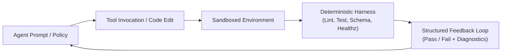

# AI Agent Harness Engineering & Marketplace Packaging

이 스킬은 **AI Agent Engineer**가 대규모 언어 모델(LLM)과 자율 코딩 에이전트가 신뢰할 수 있는 방식으로 코드를 생성·검증할 수 있도록 **평가 하네스(Evaluation Harness)**를 구축하고, 에이전트 스킬/플러그인을 **3rd-Party Marketplace 규격**으로 패키징할 때 사용하는 표준 실행 지침입니다.

---

## 1. What is Agent Harness Engineering? (하네스 엔지니어링이란?)

**하네스 엔지니어링(Harness Engineering)**은 AI 에이전트가 "코드 작성을 완료했다"고 착각하는 환각(Hallucination)을 막고, 실제 환경에서 소프트웨어를 자율적으로 빌드하고, 테스트를 통과시키며, 오류를 스스로 치유(Self-healing)할 수 있도록 감싸는 **결정론적 평가 및 실행 인프라**를 설계하는 공학입니다.

### 핵심 4대 구성 요소


1. **Deterministic Oracles (결정론적 오라클)**:
   - LLM이 자신의 출력을 평가하게 하지 않습니다. 컴파일러, 린터, 유닛 테스트 러너, HTTP 헬스체크 등 결정론적 도구로 결과를 판정합니다.
2. **Standardized Tool Contracts (표준 툴 계약)**:
   - 도구(Tool) 및 MCP(Model Context Protocol) 서버의 입출력 스키마(JSON Schema)를 엄밀히 정의하여 도구 오작동(Schema mismatch)을 0%로 줄입니다.
3. **Self-Healing Feedback Loops (자가 치유 피드백 루프)**:
   - 테스트 실패 시 원시 스택 트레이스와 실패 입력값을 정형화된 JSON 또는 마크다운 진단 보고서로 에이전트에게 재전송하여 닫힌 루프(Closed-loop) 내에서 자가 수정하게 만듭니다.
4. **Regression Evaluation (회귀 평가 벤치마크)**:
   - 시스템 프롬프트, 룰, 스킬 수정 시 이전 정상 동작 케이스들이 깨지지 않는지 골든 태스크(Golden Tasks) 스위트로 회귀 평가를 수행합니다.

---

## 2. 3rd-Party Agent Marketplace Specification (마켓플레이스 규격)

Antigravity 및 글로벌 에이전트 마켓플레이스에서 타 팀이나 외부 사용자가 3rd party 플러그인/스킬로 설치할 수 있도록 다음 표준 번들 구조를 준수합니다.

### 1) Plugin Directory Layout
```text
<plugin-root>/
├── plugin.json              # 필수: 플러그인 메타데이터 매니페스트 (JSONC)
├── README.md                # 필수: 사용자 안내 및 퀵스타트 문서
├── skills/                  # 스킬 번들 디렉터리
│   └── <skill-name>/
│       ├── SKILL.md         # 필수: YAML frontmatter (name, description)
│       ├── references/      # 심화 지침 및 런북
│       └── scripts/         # 크로스 플랫폼 실행 스크립트 (.ps1 & .sh)
├── rules/                   # 플러그인 활성화 시 항시 적용되는 헌법
│   └── AGENTS.md
└── mcp_config.json          # 선택: MCP 도구 서버 연동 설정
```

### 2) `plugin.json` Manifest Schema
```json
{
  "name": "dev-team-skills",
  "displayName": "Dev Team Skills & Engineering Squad",
  "version": "1.1.0",
  "description": "Cross-platform Pragmatic Engineering Squad (8 Roles), Brainstorming, Code Review, AI Agent Harness & Ponytail Minimalism.",
  "author": "DongJinNam",
  "homepage": "https://github.com/DongJinNam/dev-team-skills",
  "repository": {
    "type": "git",
    "url": "https://github.com/DongJinNam/dev-team-skills.git"
  },
  "suggestedPrompts": [
    "기획자 및 AI 하네스 엔지니어를 포함해 신규 기능 개발 스쿼드를 구성해줘",
    "린 캔버스와 브레인스토밍 기법으로 요구사항을 정의하고 PRD를 작성해줘",
    "AI 에이전트의 자가 검증을 위한 Harness Test 및 Eval 루프를 설계해줘"
  ]
}
```

- **`name`**: 전역 고유한 소문자 kebab-case 식별자.
- **`description`**: 마켓플레이스 검색 엔진이 색인하는 1~2문장의 핵심 설명.
- **`suggestedPrompts`**: 마켓플레이스 UI 카드에 표시될 정확히 3개의 예시 프롬프트.

---

## 3. Harness Test Design & Verification Pattern (하네스 테스트 설계)

### 1) 에이전트 자가 검증 하네스 스크립트 구축 원칙
- **크로스 플랫폼 필수**: Windows(PowerShell `.ps1`)와 macOS/Linux(Bash `.sh`) 양쪽 스크립트를 반드시 페어로 제공합니다.
- **명시적 종료 코드 (Exit Codes)**: 성공 시 `0`, 실패 시 `1`을 명확히 반환하여 CI/CD 및 에이전트 루프가 즉각 감지하게 합니다.
- **최소 외부 의존성**: 별도 패키지 매니저 설치 없이 기본 OS 셸 내장 기능(PowerShell 내장 cmdlet, POSIX 셸 문법)으로 동작해야 합니다.

### 2) 골든 태스크(Golden Task) Eval 구조
```text
evals/
├── tasks/
│   ├── task_01_feature_scaffold/
│   │   ├── prompt.txt           # 에이전트에게 부여할 입력 지침
│   │   ├── expected_files.json   # 생성되어야 하는 파일 목록
│   │   └── verify.sh (.ps1)      # 하네스 검증 스크립트
│   └── task_02_refactor_minimal/
└── run-evals.ps1 (.sh)          # 전체 태스크 실행 및 통과율 집계
```

---

## 4. AI Agent Engineer Responsibilities in Squad

엔지니어링 스쿼드 파이프라인에서 AI Agent Engineer는 다음 책임을 수행합니다:

1. **Stage 1 (하네스 & 스펙 정의)**:
   - 기획서(PRD)를 수신하여 각 서브에이전트가 검증할 수 있는 자동화 테스트 하네스 기준(Definition of Done)을 Squad Lead와 함께 설계.
2. **Stage 3 (통합 품질 & 에이전트 하네스 검증)**:
   - 서브에이전트들이 생성한 코드의 스키마 적합성 및 툴 호출 안전성을 평가.
   - 플러그인 번들 유효성 검사기(`verify-harness.ps1`, `verify-harness.sh`)를 가동하여 3rd party 배포 호환성 보장.
3. **Stage 4~5 (배포 및 모니터링 하네스 연동)**:
   - CI/CD 파이프라인(`verify-rules-sync.yml` 등)에 에이전트 룰 및 스킬 동기화 하네스 연결.
