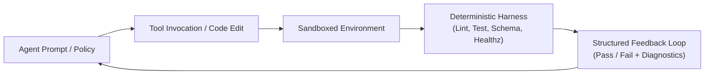

# AI Agent Harness Engineering & Marketplace Packaging

This skill is the standard execution guide for the **AI Agent Engineer**. It explains how to build **evaluation harnesses** so AI coding agents can build, test, and self-heal code reliably, and how to package agent skills to meet **3rd-Party Marketplace standards**.

---

## 1. What is Agent Harness Engineering?

**Harness Engineering** stops AI agents from hallucinating ("I wrote the code, so it's done"). It wraps the agent in a **deterministic test and execution loop** that automatically compiles code, runs tests, checks schemas, and feeds errors back for self-healing.

### The 4 Core Components


1. **Deterministic Oracles**:
   - Never let an LLM grade its own work. Use real compilers, linters, unit test runners, and HTTP health checks.
2. **Standardized Tool Contracts**:
   - Strictly define tool and MCP (Model Context Protocol) input/output schemas (JSON Schema) to eliminate tool errors.
3. **Self-Healing Feedback Loops**:
   - When a test fails, feed the stack trace and input back to the agent in structured JSON or Markdown so it can fix itself.
4. **Regression Evaluation**:
   - Run a suite of golden tasks when system prompts, rules, or skills change to ensure existing capabilities do not break.

---

## 2. 3rd-Party Agent Marketplace Specification

To let other teams or users install your skills as 3rd-party plugins on Antigravity, Claude Code, and Codex, follow this layout:

### 1) Plugin Directory Layout
```text
<plugin-root>/
├── plugin.json              # Required: Plugin metadata manifest (JSONC)
├── README.md                # Required: User instructions & quickstart
├── skills/                  # Skills bundle directory
│   └── <skill-name>/
│       ├── SKILL.md         # Required: YAML frontmatter (name, description)
│       ├── references/      # In-depth guides and runbooks
│       └── scripts/         # Cross-platform scripts (.ps1 & .sh)
├── rules/                   # Constitution rules loaded when plugin is active
│   └── AGENTS.md
└── mcp_config.json          # Optional: MCP tool server configuration
```

### 2) `plugin.json` Manifest Schema
```json
{
  "name": "dev-team-skills",
  "displayName": "Dev Team Skills & Engineering Squad",
  "version": "1.1.0",
  "description": "Cross-platform Pragmatic Engineering Squad (8 Roles), Brainstorming, Code Review, AI Agent Harness & Ponytail Minimalism.",
  "author": "DongJinNam",
  "homepage": "https://github.com/DongJinNam/dev-team-skills",
  "repository": {
    "type": "git",
    "url": "https://github.com/DongJinNam/dev-team-skills.git"
  },
  "suggestedPrompts": [
    "Assemble an engineering squad including a Product Planner and AI Agent Engineer",
    "Define requirements and write a Lean PRD using brainstorming frameworks",
    "Design a deterministic test harness and eval loop for AI agent self-verification"
  ]
}
```

- **`name`**: Unique, lowercase kebab-case ID.
- **`description`**: 1-2 sentence overview indexed by marketplace search engines.
- **`suggestedPrompts`**: Exactly 3 example prompts displayed on marketplace cards.

---

## 3. Harness Test Design & Verification Pattern

### 1) Principles for Agent Self-Verification Scripts
- **Must Be Cross-Platform**: Always provide both Windows PowerShell (`.ps1`) and macOS/Linux Bash (`.sh`) scripts.
- **Explicit Exit Codes**: Return `0` on success and `1` on failure so CI/CD and agent loops immediately catch issues.
- **Minimal Dependencies**: Use built-in OS shell features (PowerShell cmdlets, POSIX bash) without requiring extra package managers.

### 2) Golden Task Eval Structure
```text
evals/
├── tasks/
│   ├── task_01_feature_scaffold/
│   │   ├── prompt.txt           # Input instructions for the agent
│   │   ├── expected_files.json   # Files that should be created
│   │   └── verify.sh (.ps1)      # Verification script
│   └── task_02_refactor_minimal/
└── run-evals.ps1 (.sh)          # Runs all tasks and reports pass rate
```

---

## 4. AI Agent Engineer Responsibilities in Squad

In the Engineering Squad pipeline, the AI Agent Engineer handles:

1. **Stage 1 (Harness & Spec Definition)**:
   - Takes the PRD and designs automated test harness criteria (Definition of Done) together with the Squad Lead.
2. **Stage 3 (Integration Quality & Agent Harness Verification)**:
   - Verifies schema accuracy and safe tool calls for all generated code.
   - Runs verification harness scripts (`verify-harness.ps1`, `verify-harness.sh`) to ensure 3rd-party marketplace compatibility.
3. **Stage 4–5 (Deployment & Monitoring Harness)**:
   - Connects agent rule and skill sync harnesses to CI/CD pipelines (such as `verify-rules-sync.yml`).
